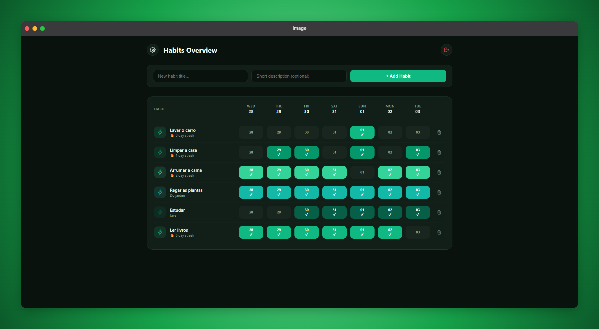
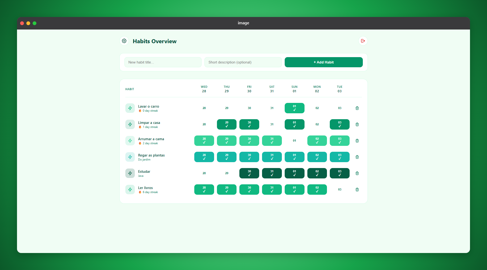
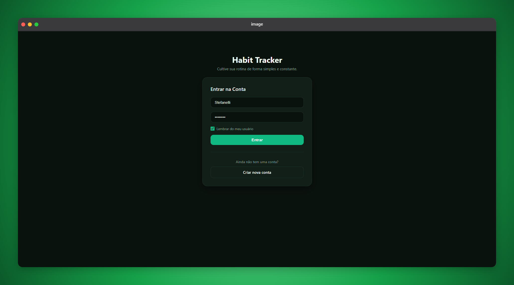
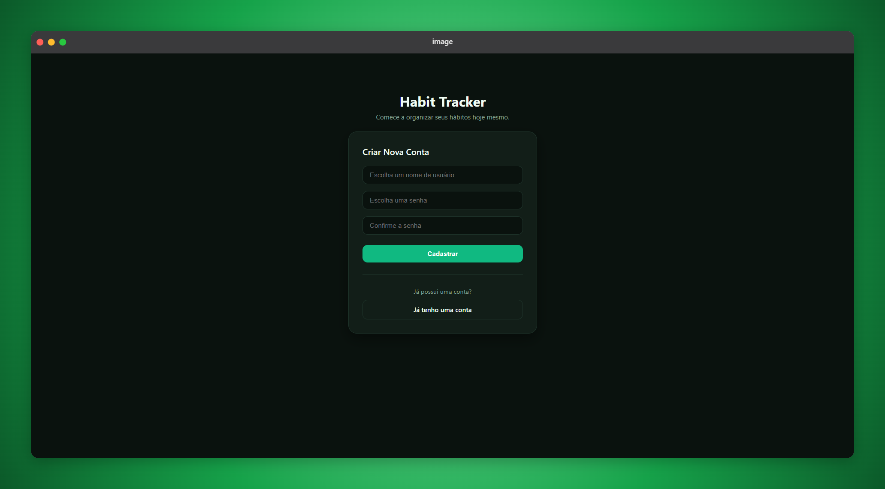
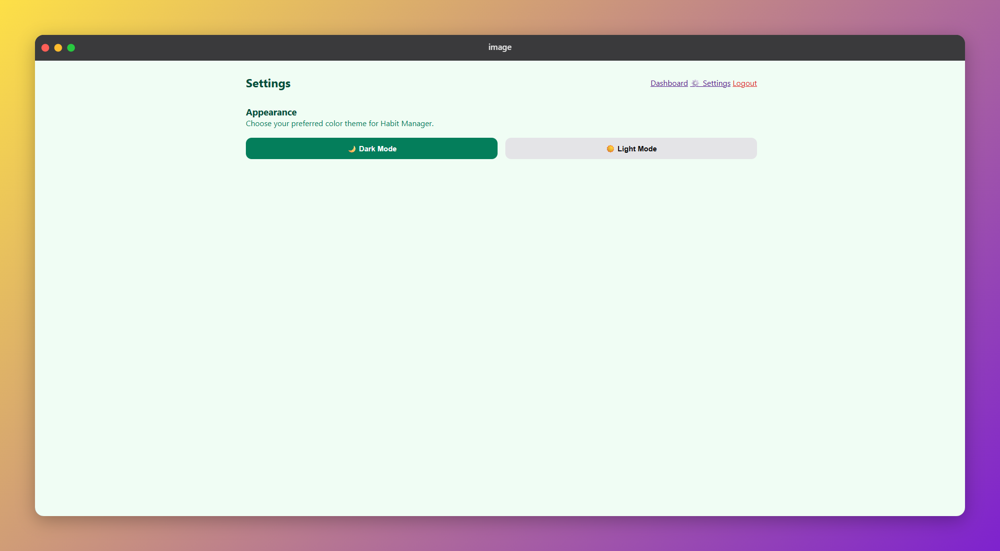

# Habit Manager

A modern, lightweight, and responsive web application for tracking daily habits, built with FastAPI, HTMX, Jinja2, and SQLite.

The project features individual user authentication, a heatmap-style grid history for the last 7 days, dark/light theme switching, and full containerized deployment support with Docker.

## Interface and Features

### Dashboard (Desktop View and Heatmap)
Grid visualization tracking your habits across the last 7 days. Toggle check-ins with a single click without refreshing the page.

### User Authentication
Dedicated Login and Register pages with secure password hashing (PBKDF2-SHA256), a "Remember Me" option, and password confirmation validation.

| Login Screen | Register Screen |
| :---: | :---: |
|  |  |

### Settings and Themes
Full support for switching between Dark Mode and Light Mode with a natural emerald green palette, persisted in the browser via localStorage.

## Features

- Grid Tracking (Heatmap): Track your progress over the last 7 days with automatic streak calculation.
- HTMX Interactivity: Create, toggle, and delete habits in real time without reloading the page.
- User Authentication System: Data isolation per user (each account only accesses its own habits).
- Responsive and Themed Design: Modern dashboard interface with Dark/Light Mode support.
- Lightweight Persistence: Fast SQLite database with environment variable support (DB_PATH).

## Tech Stack

- Backend: Python 3.12, FastAPI, Uvicorn
- Frontend: HTML5, CSS3 (Custom CSS variables), Jinja2, HTMX
- Database: SQLite3
- DevOps: Docker, Docker Compose